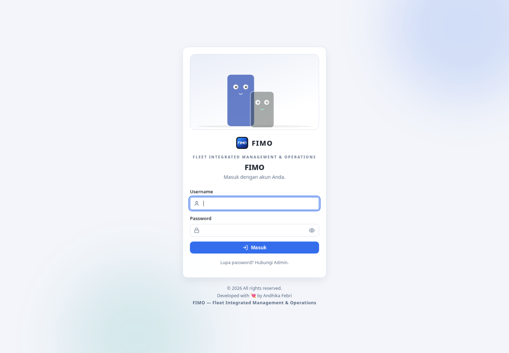

# FIMO — Fleet Integrated Management & Operations

> **Edisi referensi terbuka (open reference edition).** Repositori ini adalah
> snapshot aplikasi FIMO versi staging yang diterbitkan sebagai referensi
> publik — terutama bagi pemangku kebijakan dan pengembang yang ingin
> mempelajari atau membangun sistem serupa untuk operasional angkutan umum
> berbasis skema kontrak *gross-cost*/PSO sebagaimana diatur dalam
> **Pergub DIY No. 110 Tahun 2024** tentang Penyelenggaraan Sistem Angkutan
> Perkotaan. Database dan backend produksi **tidak** termasuk
> dalam repositori ini; lihat [OPEN-EDITION.md](OPEN-EDITION.md) untuk ruang
> lingkup lengkapnya.

**FIMO** adalah aplikasi administrasi untuk operasional **Angkutan Perkotaan** di
**Operator A**, Unit Transportasi, Yogyakarta.

Aplikasi ini menggabungkan dua aplikasi
lama yang dulu terpisah — dashboard **Branding** (booking iklan di bodi bus) dan
**Subsiditrack** (klaim subsidi operasional) — menjadi **satu aplikasi, satu
database, dan satu pintu login** untuk semua pekerjaan administrasi.

## Alamat aplikasi

| Keperluan | Alamat |
|---|---|
| **Aplikasi utama (production)** | **https://fimo.example.com** |
| Lingkungan uji coba (staging) | https://oms-staging.your-staging.workers.dev |

Login memakai **username + password** yang dibuatkan oleh superadmin. Tidak ada
pendaftaran publik — kalau belum punya akun, minta dibuatkan ke admin.

## Tampilan aplikasi

Halaman login (identitas visual edisi terbuka):

Halaman **Home** — halaman pertama setelah login. Semua modul tampil sebagai
kartu besar; tinggal klik yang mau dikerjakan:

Di **HP**, tampilannya menyesuaikan: ada **menu bawah 5 tab** (Home, Branding,
Klaim, SPM, App) seperti aplikasi biasa, dan FIMO bisa **diinstal ke layar
depan HP** tanpa Play Store (lihat caranya di bawah).

Dashboard berisi ringkasan eksekutif lintas modul:

Modul **Denda SPM** (backend database penuh sejak v1.1.1: impor CSV dua arah
Dishub ↔ operator, rekonsiliasi, dan penetapan denda bersnapshot tarif;
rekonsiliasi otomatis aturan 3 jam sejak v1.2.3):

**Application Hub** — jalan pintas ke aplikasi kerja lain (Ticketing, GPS,
CCTV, Webmail, ERP, dan lainnya) dari satu tempat:

## Baru di v1.2.3 (13 November 2026, stable di production)

- **Rekonsiliasi otomatis Denda SPM.** Impor CSV operator kini mencocokkan
  temuan secara otomatis; untuk pelanggaran bus trouble (OP-006), durasi
  penanganan operator di bawah 3 jam membuat temuan berstatus *Klarifikasi
  Diajukan* dan gugur dari penetapan. Keputusan review berupa dua tombol
  **Disetujui / Disanggah**; penetapan hanya menerima temuan Disetujui.
  Riwayat berkas berpaginasi (5/10/25/100/Semua) dan perbandingan temuan
  berkelompok per bulan.
- **FIMO Agent (v1.2.0, staging).** Asisten tanya-jawab data di menu Agent:
  membaca database lewat view read-only dengan scope dikunci di level
  database mengikuti matriks akses akun; setiap percakapan tercatat di
  audit. Belum diaktifkan di production.
- **Menu Setting terpadu (v1.1.8).** Pricelist Branding, Master Data Klaim,
  dan Besaran Denda SPM kini berada di grup Setting.
- **Verifikasi klaim per item (v1.1.7).** Nilai Verifikasi dan Tidak Cair
  per baris biaya/pendapatan, tanpa menimpa nilai usulan.
- **Perbaikan integritas simpan klaim (v1.1.5–v1.1.6)** dan **login guard
  (v1.1.2)**: rate limit login, maksimal 9 sesi per akun, umur sesi 20 jam.
- Rincian lengkap per versi ada di [CHANGELOG.md](CHANGELOG.md).

## Baru di v1.1.1 (11 November 2026)

- **Hak akses per akun yang jauh lebih rinci.** Superadmin mengatur akses tiap
  akun lewat matriks centang: per modul (Baca/Tulis), turun sampai per submenu
  — bahkan per shortcut di Workspace. Menu yang tidak dicentang tidak tampil
  sama sekali di akun itu. Manajemen User kini berada di grup **Setting**.
- **Pencarian global.** Kotak pencarian di header mencari lintas modul
  (armada, booking, klaim, SPM, workspace, pengguna) sesuai izin akun, lengkap
  dengan saran berketerangan; mengetik nopol/nomor lambung yang tepat membuka
  kartu sorotan bus beserta booking-nya. Halaman Branding punya kotak khusus
  **Cari nomor lambung**.
- **Override total hasil nego (Branding).** Total transaksi yang dinego bisa
  diubah tanpa menyentuh pricelist: yang disimpan adalah rasio kesepakatan
  beserta alasan wajibnya (tercatat di audit), dan total efektifnya mengalir
  ke laporan, resume dashboard, dan surat. Hanya akun yang dicentang khusus
  oleh superadmin (dan superadmin sendiri) yang bisa memakai fitur ini.
- **Denda SPM sudah memakai database sungguhan** (impor CSV dua sisi,
  rekonsiliasi, penetapan) — bukan lagi demo.
- **Penyimpanan berkas bertahap ke server kantor (self-hosted)** untuk staging;
  production menyusul dengan proses terpisah.
- **Fondasi AI Agent**: tampilan data read-only khusus agent sudah disiapkan
  di database (belum ada antarmuka pengguna).

## Modul dan statusnya

| Modul | Gunanya | Status |
|---|---|---|
| **Branding FIMO** | Data bus, booking branding (bisa banyak bus sekaligus dengan satu Nomor Referensi), pricelist + PPN dengan harga yang terkunci sebagai snapshot, dokumen administrasi, Nota Dinas resmi format Operator A, surat penawaran & konfirmasi, laporan | ✅ Dipakai |
| **Klaim Subsidi** | Pengajuan klaim subsidi operasional (Kepgub DIY No. 524/KEP/2024): rincian biaya, perhitungan otomatis, alur verifikasi berjenjang, dokumen bukti, surat klaim, laporan | ✅ Dipakai |
| **Photo Stamp** | Memberi stempel tanggal/waktu/lokasi pada foto lapangan (FIMO-Stamp) | ✅ Dipakai |
| **Application Hub & Work Drive** | Kumpulan tautan ke aplikasi dan berkas kerja eksternal | ✅ Dipakai (daftar tautan masih diatur di kode, belum bisa diedit dari aplikasi) |
| **Denda SPM** | Mengolah temuan pelanggaran standar pelayanan dari Dishub menjadi denda per operator: impor CSV dua sisi, rekonsiliasi, penetapan, riwayat | ✅ Dipakai — data sudah tersimpan di database; tarif yang terpasang masih tarif awal dan **menunggu verifikasi tarif resmi** dari Dishub |

## Cara memakai (untuk staf)

1. Buka **https://fimo.example.com**, login dengan username dan password.
2. **Login pertama kali?** Anda wajib mengganti password dulu sebelum bisa
   masuk. Ingat password baru Anda — tidak ada fitur "lupa password" mandiri;
   kalau lupa, minta superadmin untuk meresetkan.
3. Setelah masuk, Anda tiba di halaman **Home**. Klik kartu modul yang mau
   dikerjakan. Menu lengkap juga ada di panel samping (di HP: tombol ☰ atau
   usap dari tepi kiri layar).
4. **Instal di HP (opsional, disarankan):** buka alamat di atas di Chrome HP →
   menu **⋮** → **"Install app" / "Tambahkan ke Layar Utama"**. Ikon FIMO akan
   muncul di layar depan dan aplikasi terbuka layar penuh seperti aplikasi
   biasa. Ini bukan APK — tidak perlu Play Store dan tidak memakan tempat
   besar.
5. Di HP, pakai **menu bawah** untuk pindah modul dengan cepat. Tab Branding,
   Klaim, dan SPM membuka pilihan isi menunya dalam bentuk kartu; tab **App**
   membuka Application Hub.
6. Selesai bekerja, keluar lewat menu akun di kanan atas.

Menu yang tampil mengikuti hak akses akun Anda: staf biasa melihat modul kerja
hariannya; menu admin (manajemen user, Denda SPM, Application Hub) hanya untuk
superadmin.

## Untuk pengembang

- **Stack:** Next.js 16 / React 19 / TypeScript di Cloudflare Workers
  (OpenNext), database & login di Supabase (PostgreSQL), PDF memakai pdf-lib,
  CSS vanilla tanpa framework UI.
- **Dokumentasi teknis lengkap** ada di folder [`docs/`](docs/README.md) —
  arsitektur, skema database, aturan bisnis per modul, sampai prosedur deploy.
  Mulai dari [Overview](docs/01-overview.md).
- **Menjalankan lokal:** `npm install`, siapkan `.env.local` (salin dari
  `.env.example`, isi dari pengelola repo), lalu `npm run dev`.
- **Aturan main perubahan kode:**
  1. Selalu mulai dari branch `main` terbaru, kerjakan di branch terpisah.
  2. Uji dulu di **staging** — jangan langsung ke production.
  3. Klaim selesai hanya bila `npx tsc --noEmit`, build, dan suite E2E terkait
     lulus dengan angka nyata.
  4. Deploy production hanya atas persetujuan eksplisit pemilik.
- **Backup:** database production dan staging dicadangkan otomatis (arsip zip
  terverifikasi + uji restore berkala) ke penyimpanan lokal dan Google Drive
  pengelola.
- Riwayat perubahan tercatat di [CHANGELOG.md](CHANGELOG.md).

---

FIMO Angkutan Perkotaan v1.2.3 — © 2026 Operator A.
Dikembangkan oleh Andhika Febri.
