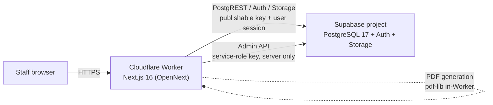

# 02 — Architecture

## System context



One application, one database. All modules share the platform tables (users, roles,
permissions, audit) and prefix their own tables (`branding_*`, `claim_*`).

## Technology stack

| Layer | Choice | Version (from `package.json`) |
|---|---|---|
| Framework | Next.js (App Router) | `^16.0.0` |
| UI runtime | React / ReactDOM | `^19.2.0` |
| Language | TypeScript | `^5.7.0` |
| Hosting adapter | `@opennextjs/cloudflare` | `^1.20.16` |
| Hosting | Cloudflare Workers (`workerd`, `nodejs_compat`, compatibility date `2025-09-01`) | Wrangler `^4.158.0` |
| Database/Auth/Storage | Supabase (`@supabase/supabase-js` `^2.58.0`, `@supabase/ssr` `^0.12.7`) | PostgreSQL 17 |
| PDF | `pdf-lib` | `^1.17.1` |
| Icons | `lucide-react` | `^1.70.0` |
| Styling | Vanilla CSS with CSS variables (dark/light via `data-theme`) | — |
| Node.js (build/dev) | `>=24` (`.nvmrc`: `24`) | — |

There is intentionally **no CSS framework and no chart library**: charts are hand-rolled
SVG components (see [Design System](11-design-system.md)). New dependencies require a
clear need; the dependency list above is the complete runtime set.

## Request flow

```mermaid
sequenceDiagram
  participant B as Browser
  participant M as middleware.ts
  participant P as Page / API route
  participant A as lib/auth.ts
  participant S as Supabase (RLS)
  B->>M: request + session cookie
  M->>M: refresh session (SSR client); public paths: /login, /api/auth/login
  M-->>B: 401 / redirect to /login when unauthenticated
  B->>P: authenticated request
  P->>A: requireContext(permission) / apiContext(permission)
  A->>S: profile + roles + permissions
  A-->>P: SessionContext or denial
  P->>S: queries via session client (RLS enforced)
  S-->>P: rows the user's permissions allow
```

Authorization is enforced at **three layers** that must agree: UI visibility, server
guards (`requireContext`/`apiContext`), and PostgreSQL RLS as the final enforcer.
See [Auth, RBAC & RLS](08-auth-rbac-rls.md).

## Repository structure

```
app/
  (app)/            Authenticated shell (sidebar/header) and all module pages
    page.tsx        Main dashboard (executive overview)
    branding/       Branding pages: overview, bookings, buses, pricing, documents, reports
    claim/          Claim pages: overview, list, [id] detail, verify, master, reports
    admin/users/    User management (superadmin)
    photo-stamp/    Photo Stamp shell page (iframe embed)
  api/              Route handlers (auth, account, admin, branding/*, claim/*)
  login/            Login page (public)
  change-password/  Forced/voluntary password change
  layout.tsx        Root layout; globals.css; icon.svg / apple-icon.png
components/         Shared UI (sidebar, account menu, footer, logo, modals, BusPicker…)
components/dashboard/  Dashboard kit: Dash.tsx (cards/charts), CountUp.tsx
lib/
  auth.ts           Session context + guards (the authorization gateway)
  supabase/         server.ts (session client), admin.ts (service-role client)
  branding.ts       Branding domain: statuses, duration & pricing rules, formatting
  branding-server.ts  Server-side pricing snapshot engine
  claim.ts          Claim domain: statuses, tax & subsidy calculation
  claim-server.ts   Server-side claim helpers (validation, totals)
  pdf.ts            pdf-lib builders (letters, Nota Dinas rich builder)
  nota-pdf.ts       Nota Dinas composition
  nota-trayek.ts    Route (trayek) master data for Nota Dinas attachments
  terbilang.ts      Indonesian number-to-words for payment amounts
supabase/
  migrations/       5 ordered SQL migrations (see 07-database-schema.md)
  tests/            5 SQL test suites, one per migration
scripts/
  e2e-*-test.py     End-to-end suites (auth 25, branding 27, claim 22 checks)
  etl-*.py          Legacy data migration (Firestore / subsiditrack → Supabase)
  deploy-worker-api.py  Alternative Worker deploy via Cloudflare API
public/fimo-stamp-app/  Vendored static FIMO-Stamp V2 application (Photo Stamp module)
prep/               Reference assets kept with the project (official logo source, study notes)
```

## Design principles

- **Database is the last enforcer.** Anything that must never happen (double-booking a
  bus, editing a FINAL Nota Dinas, illegal claim status jumps, removing the last
  superadmin) is a trigger/constraint, not just UI logic.
- **Snapshots over recomputation.** Booking prices and claim versions are frozen at
  creation; later pricelist/master changes never rewrite history.
- **Audit by default.** Sensitive mutations write to the append-only `audit_events`
  table through the `log_audit()` RPC.
- **Free-tier first.** No paid service is required to run the system today; known
  free-tier risks.
