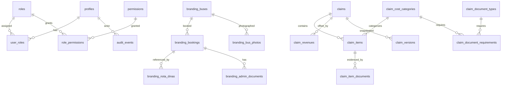

# 07 — Database Schema

PostgreSQL 17 (Supabase). All schema changes are ordered SQL migrations in
`supabase/migrations/`, each with a test suite in `supabase/tests/`. RLS is enabled on
every application table with default-deny policies (65 policies in total).

## Migrations

| File | Contents | SQL tests |
|---|---|---|
| `202611080001_foundation_auth.sql` | Platform: profiles, roles, permissions, audit, module registry | 17/17 (`0001`) |
| `202611080002_branding.sql` | Branding: 8 tables, pricing, nota, private bucket `branding-docs` | 16/16 (`0002`) |
| `202611080003_claim.sql` | Claim: 11 tables, workflow guard trigger, private bucket `claim-docs` | 15/15 (`0003`) |
| `202611080004_booking_exclusivity.sql` | One active booking per bus per period (conflict trigger rework) | 5/5 (`0004`) |
| `202611090005_booking_reference.sql` | `branding_bookings.reference_no` (`REF-YYYYMM-XXXXXXXX`, backfill, NOT NULL, unique index) | in `0005` |
| `202611100006_bus_master.sql` | Official 130-bus master data load | — |
| `202611100007_workspace_registry.sql` | Workspace module registry entry | — |
| `202611110008_module_access.sql` | Per-account module matrix `user_module_access`, `has_permission()` matrix layer, role-preset trigger, existing-account seed | 12/12 (`0008`) |
| `202611110009_agent_contract.sql` | Nine `agent_*` read-only views; three NOLOGIN read-only roles (`fimo_ro_superadmin/branding/klaim`) | grant matrix + live connection test |
| `202611110010_spm_backend.sql` | SPM tables (`spm_violation_rates`, `spm_import_batches`, `spm_findings`, `spm_penalties`), `spm.view/manage`, 53 seeded rates (unverified) | (`0010`) |
| `202611110011_storage_backend.sql` | `storage_backend` column on the three document tables (Supabase ↔ self-hosted MinIO switch) | (`0011`) |
| `202611110012_feature_access.sql` | Per-submenu checkboxes `user_feature_access`; `has_permission()` v2 subtracts denied feature codes; PhotoStamp registry activated + backfill | (`0012`) |
| `202611110013_total_override.sql` | Negotiated-total ledger `branding_total_adjustments` (one active row per transaction group, mandatory reason); `branding.total.override` (superadmin role + opt-in GRANT feature); `has_permission()` v3 | (`0013`) |
| `202611110014_custom_role.sql` | Third role preset `custom` (no preset permissions — module/feature matrix only) | (`0014`) |
| `202611120015_login_guard.sql` | `login_attempts` (rate limit: lock 15 min after 10 failures/username, 50/IP), max 9 sessions per account, 20-hour session age | 7/7 (`0015`) |
| `202611120016_upload_limits.sql` | Per-slot upload size limits (PKS 5 MB; invoice/transfer/kwitansi/faktur 2 MB; bus photo 1 MB; claim documents 20 MB) | (`0016`) |
| `202611120017_claim_verification.sql` | `verified_amount` on `claim_items` + `claim_revenues`; `total_verified_operational_cost`, `calculated_verified_subsidy`, `verified_at` on `claims` (proposals never overwritten) | 5/5 (`0017`) |
| `202611130018_agent_bridge_roles.sql` | Combined read-only role `fimo_ro_branding_klaim` (Branding+Claim views, no audit view); Bridge login `fimo_agent_sa` membership in all scope roles for per-session `SET LOCAL ROLE` | (`0018`) |
| `202611130019_spm_rekon_otomatis.sql` | `spm_findings`: two-sided stop/resume times (`dishub_stop_at/resume_at`, `operator_stop_at/resume_at`) + computed durations (`*_duration_min`); statuses `Klarifikasi Diajukan`/`Disetujui`/`Disanggah`; Dishub duration backfill parsed from narrative ("NNN Menit", 135 rows) | ALL PASS (`0019`) |

## Entity overview (ERD, simplified)

## Platform tables (migration 0001)

| Table | Purpose |
|---|---|
| `profiles` | One row per auth user: username, display name, active flag, `must_change_password`. Sensitive columns guarded by trigger. |
| `roles` | `superadmin`, `admin`. |
| `permissions` | 28 permission codes (`<module>.<resource>.<action>`). |
| `role_permissions` | Role → permission grants (superadmin 28, admin 22). |
| `user_roles` | User → role assignments; last-superadmin guards live here. |
| `module_registry` | Module catalogue driving the sidebar (`branding`, `claim`, `photo_stamp`, `spm`) with active flags and sort order. |
| `audit_events` | Append-only audit trail: `actor_id`, `module_code`, `action`, `entity_type`, `entity_id`, `detail` (jsonb), `created_at`. Written via `log_audit()`; no update/delete policies exist. |

## Branding tables (migration 0002, + 0004, + 0005)

| Table | Purpose / key columns |
|---|---|
| `branding_buses` | Bus master. `no_polisi` unique; `fleet_no`, `hull_no`, `bus_type`, `route` (legacy jalur), `color`, `body_maker`. |
| `branding_bookings` | Booking per bus & period: `placement` (`FULL_BODY`/`SIDE_BODY`/`BACK_BODY`), stored `status` (`BOOKING`/`PROSES`/`BERJALAN`/`SELESAI`), `pricing_snapshot` (jsonb, frozen), `reference_no` (0005). |
| `branding_pricing_config` | Versioned pricelist rows + VAT (PPN) configuration; publishing supersedes, never edits history. |
| `branding_reference_options` | Reference/option lists used by document forms. |
| `branding_admin_records` | Per-client (brand) administrative records. |
| `branding_admin_documents` | Uploaded admin files metadata (PKS, invoice, transfer proof, receipt, tax invoice) → `branding-docs` bucket paths. |
| `branding_bus_photos` | Bus branding photos metadata → `branding-docs`. |
| `branding_nota_dinas` | Nota Dinas: unique `number`, `booking_id`, `payment_terms` (jsonb), `body` (jsonb, incl. reference letter fields and deadlines), `status` (`DRAFT`/`EDITED`/`FINAL`). |

## Claim tables (migration 0003)

| Table | Purpose |
|---|---|
| `claims` | Claim header: operator, PIC, period month/year, totals (`total_direct_cost` … `calculated_subsidy`, all `numeric(20,2)`), `status` (7 states), submission date. |
| `claim_items` | Cost items per claim, linked to categories; tax mode + computed amounts. |
| `claim_item_documents` | Evidence files per item → `claim-docs` bucket (checksum, page count). |
| `claim_revenues` | Ticket/branding revenues offsetting the subsidy. |
| `claim_versions` | Frozen snapshots at each submission. |
| `claim_cost_categories` | Category tree (127 rows after ETL) with roll-up kinds. |
| `claim_document_requirements` | Category × document-type requirements (735 rows after ETL). |
| `claim_document_types` | Evidence document types. |
| `claim_vehicle_types` | Vehicle types; the code letter feeds claim numbers. |
| `claim_regulation_versions` | Regulation references (Kepgub DIY 524/KEP/2024 lineage). |
| `claim_letter_templates` | Claim letter templates (letterhead + body). |

## Database functions (RPC surface)

| Function | Role |
|---|---|
| `has_permission(text)` | Central authorization check used by RLS and the app. |
| `is_superadmin()` | Role shortcut for guards/policies. |
| `log_audit(...)` | The only sanctioned way to write audit events. |
| `handle_new_user()` | Trigger: creates a `profiles` row for a new auth user. |
| `branding_check_conflict(...)` | Booking overlap check used by the conflict trigger. |
| `branding_effective_status(...)` | Stored status + end-date → effective status. |
| `branding_nota_final_guard()` | Trigger: FINAL nota is immutable. |
| `claim_guard_transition()` | Trigger: legal claim status transitions only. |
| `guard_last_superadmin_assignment()` / `guard_last_superadmin_deactivation()` | The last superadmin can neither lose the role nor be deactivated. |
| `guard_profile_sensitive_columns()` | Non-privileged users cannot change role/audit-sensitive profile columns. |
| `set_updated_at()` | Shared `updated_at` maintenance trigger. |

## Access & adjustment tables (migrations 0008, 0012, 0013)

- `user_module_access` — one row per (user, module): `can_read`, `can_write`
  (write implies read). Superadmin holds no rows and bypasses implicitly.
- `user_feature_access` — one row per (user, feature code). Absent row means
  the default: allowed for denial-type features, denied for GRANT-type
  features (`branding.override`).
- `branding_total_adjustments` — negotiated-total ledger keyed by transaction
  group (`transaction_key`). Stores the computed total at save time, the
  agreed total, and their `ratio`; the ratio is what stays locked, so
  effective totals follow later data changes. Partial unique index enforces
  one active adjustment per group; superseded rows remain as history.

## Storage buckets

| Bucket | Visibility | Contents |
|---|---|---|
| `branding-docs` | Private | Admin documents and bus photos (Branding). |
| `claim-docs` | Private | Claim evidence PDFs. |

Files are reached only through short-lived signed URLs minted by permission-checked
API routes. See [File Processing & Storage](12-file-storage.md).

## Invariants worth knowing

- A deactivated profile loses all permissions automatically (`has_permission` checks
  the active flag).
- Booking price snapshots and claim version snapshots are never recomputed after the
  fact.
- `reference_no` groups multi-bus submissions: one reference, many bookings, one
  document set, one Nota Dinas detail group.
