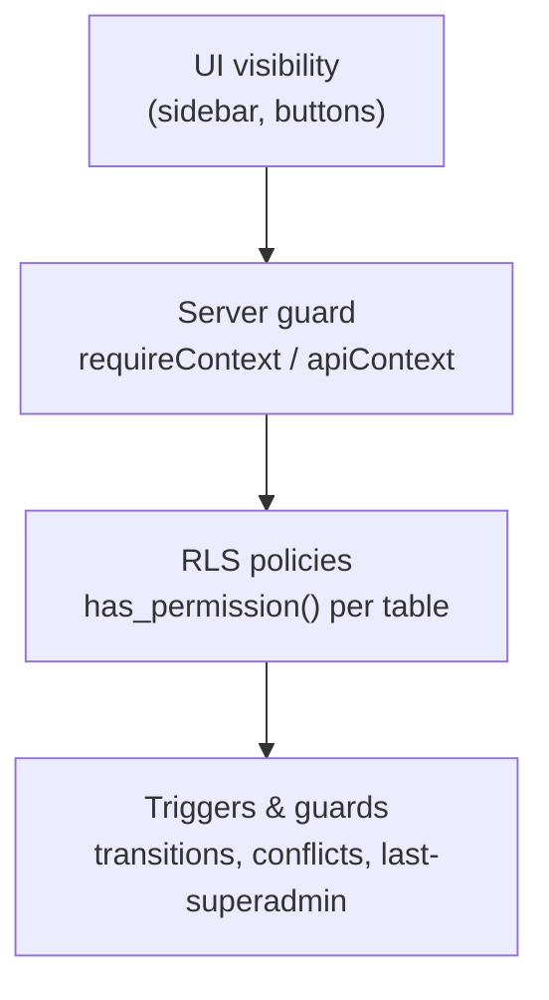

# 08 — Authentication, RBAC & RLS

## Authentication

- **Username + password only.** Usernames map to internal emails
  `<username>@oms.internal` (`lib/auth.ts`: `usernameToEmail`, domain constant
  `USERNAME_EMAIL_DOMAIN`). Users never see or use the email form.
- Sessions are Supabase Auth cookie sessions (SSR via `@supabase/ssr`), refreshed in
  `middleware.ts`. Public paths are exactly `/login` and `/api/auth/login`; everything
  else requires a session (APIs get `401`, pages redirect to `/login`).
- **Login guard** (migration 0015, constants in `lib/login-guard.ts`):
  the login route records every attempt in `login_attempts` (service-role
  only) and refuses sign-in with `error=terkunci` once failures inside a
  15-minute window — counted since the last success — reach **10 per
  username** or **50 per IP** (the IP bound is deliberately loose: one
  office sits behind a single NAT). A successful sign-in prunes the
  account to the **9 newest sessions** (`prune_user_sessions()`; revoked
  sessions lose their refresh tokens via cascade). Middleware enforces a
  **20-hour maximum session age** via `my_session_created_at()`: older
  sessions are redirected to `/api/auth/expired`, which signs out and
  lands on `/login?error=sesi`; the check fails open when the session row
  is already gone (a pruned session dies at its next refresh anyway).
- **Public sign-up is disabled** (verified). Accounts are created by a superadmin in
  the app (Supabase Admin API via the service-role client, server-side only).
- New accounts — and accounts reset by a superadmin — must change password on first
  sign-in (`profiles.must_change_password` gate → `/change-password`).
- Password policy: minimum 6 characters (owner decision). Password change verifies
  the current password; superadmin reset does not need it.

## Authorization model (RBAC)

```
user ──< user_roles >── role ──< role_permissions >── permission
                                                      "<module>.<resource>.<action>"
```

- 33 permissions are seeded. Roles are now **presets**, not the grant itself:
  since migration 0008 the effective grant is a per-account **module matrix**
  (`user_module_access`: Read/Write per module), refined since 0012 by
  **per-feature checkboxes** (`user_feature_access`). Migration 0014 adds a
  third preset, `custom`: a role with no `role_permissions` at all, so a
  custom account starts with zero access and receives everything from the
  matrix alone.
- The single check used everywhere is the SQL function `has_permission(code)`
  (v3 since migration 0013), evaluated against the **current session user**:
  superadmin bypass → `platform.*` codes from roles → module codes from the
  matrix → **GRANT features** (opt-in checkboxes such as `branding.override`
  add their code when ticked and the parent module is readable) → minus the
  codes of any denied feature. Mirrored in TypeScript by
  `permissionsFromAccess()` / `resolveFeatureAccess()` in `lib/module-access.ts`.
- Feature codes without their own permission codes (SPM submenus, workspace
  shortcuts) are enforced at the page layer via `ctx.featureAccess`, and
  navigation renders nothing an account cannot open.
- Application gateway (`lib/auth.ts`):
  - Pages: `requireContext(permission)` — throws/redirects when not permitted.
  - API routes: `apiContext(permission)` — returns `null` (→ 403) when not permitted.
  - Both return a `SessionContext` (user, profile, roles, permission set).

## Enforcement layers



All three layers must agree; RLS is the final enforcer, so a UI or API bug cannot by
itself expose data. Data queries run through the **session client** (`lib/supabase/
server.ts`) so RLS applies. The **service-role client** (`lib/supabase/admin.ts`,
bypasses RLS) is restricted to: account administration, private-storage operations,
and signed-URL minting — always behind a permission check first.

## Anti-escalation guards (database-level)

- Staff cannot write `roles`, `permissions`, `role_permissions`, or other users'
  `user_roles` (no such policies for non-superadmins).
- The **last superadmin** cannot lose the role (`guard_last_superadmin_assignment`)
  or be deactivated (`guard_last_superadmin_deactivation`,
  `profiles_guard_last_superadmin`).
- Profile sensitive columns (role-adjacent flags, active state) are trigger-guarded
  (`guard_profile_sensitive_columns`).
- Deactivating a user immediately voids all their permissions.

## Audit trail

`audit_events` is append-only (insert via `log_audit()` RPC; no update/delete
policies). Audited actions include: user create/reset/activate/deactivate, password
changes, pricing publish, bus/booking/nota mutations, claim create/submit/review
(with the `dokumen_kurang` completeness note), and deletions across modules.
The Claim overview's "latest verification activity" reads this table
(`module_code = 'claim'`).

## Security posture inherited from the legacy audit

The legacy systems' known weaknesses are closed by design here: unauthenticated APIs
(middleware + guards), cross-record IDOR (RLS per permission), public storage bucket
(private buckets + signed URLs), free-form status changes (transition trigger),
float money (numeric), and un-audited administration (append-only audit).
