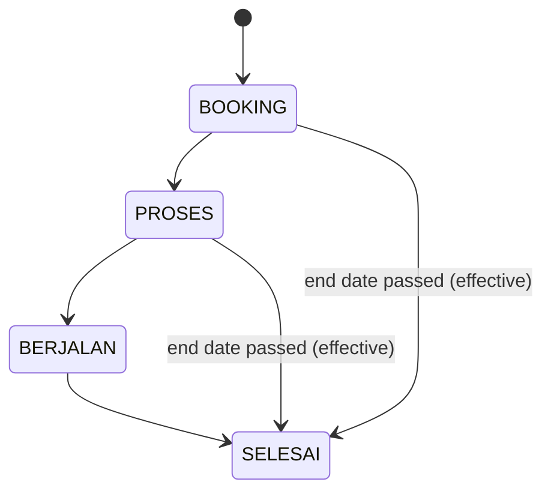
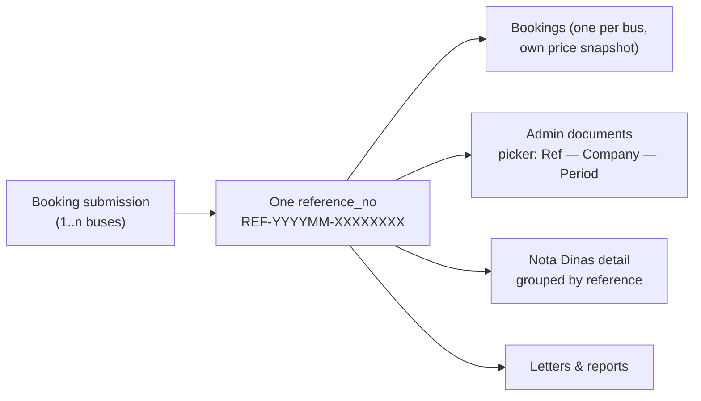
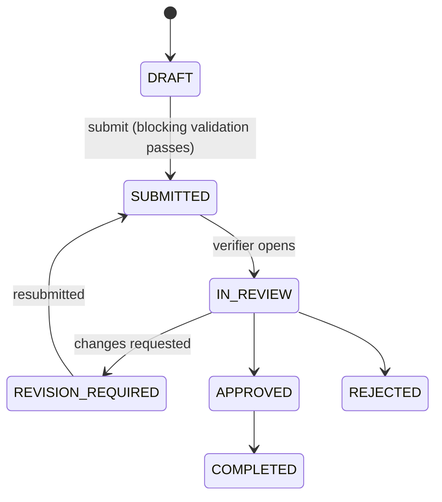

# 10 — Business Workflows

## Booking lifecycle (Branding)



- Stored statuses: `BOOKING`, `PROSES`, `BERJALAN`, `SELESAI`. The **effective**
  status also becomes `SELESAI` once the end date is in the past
  (`branding_effective_status()`); dashboards and conflict checks use effective status.
- **Duration rule** (legacy port): inclusive duration < 26 days is invalid;
  26–34 days counts as 1 month; beyond that, inclusive calendar months.
- **Pricing**: exact duration-tier price when a tier exists, otherwise the 1-month
  price × months. `SIDE_BODY` = Left + Right Body prices combined (both required).
  VAT (PPN, currently 11%) comes from pricing config. The result is frozen into
  `pricing_snapshot` = `{ pricingVersion, mediaBus, space, duration, basePrice, ppn,
  totalWithPpn, monthlyRevenue, pricingNote }`.
- **Conflict rule** (migration 0004): while a booking is active (BOOKING/PROSES/
  effective BERJALAN), no other booking may overlap that bus — regardless of
  placement. Multi-bus submissions are validated for all buses before any insert.

## Reference Number flow (migration 0005)



## Nota Dinas lifecycle

`DRAFT → EDITED → FINAL`. Numbering: `MM.DD.NNN/OPR/U.1/NDN/YYYY` (auto-generated).
FINAL is immutable (trigger). The PDF is generated on demand from the nota + all
bookings sharing its Reference Number, with totals summed from snapshots, payment
terms (single payment with amount-in-words and deadline, or 3 staged deadlines), and
the attachment (terms + route list).

## Claim lifecycle (Klaim Subsidi)



Transitions are enforced by the `claim_guard_transition` trigger — the API cannot
perform a jump the diagram does not allow. At submission, a frozen snapshot is stored
in `claim_versions`.

## Claim calculation (verified port of legacy)

```
base        = Σ direct + Σ indirect
profit      = profit% × base            (default 7%)
operational = base + profit + Σ supporting
subsidy     = operational − ticket revenue − branding revenue
```

Item tax modes: `PPN_11` (11%), `CUSTOM` (manual rate), `NONE`. Rounding is HALF_UP
to 2 decimals; all money columns are `numeric(20,2)`. Category roll-up kinds:
`DIRECT`, `INDIRECT`, `SUPPORTING` are summed; `SUBTOTAL` rows are display-only.

## Validation philosophy (Claim, owner decision 1.0.1)

- **Blocking**: missing operator/PIC/PIC title, invalid period, negative amounts,
  no cost items.
- **Warning only**: missing evidence documents (even master-mandatory ones). The
  shortfall is counted and written to the audit trail (`dokumen_kurang`); the claim
  can still be saved and submitted.

## User administration workflow

Superadmin creates an account → user signs in with the initial password → forced
password change → operational use. Superadmin can reset a password (forces change
again), deactivate (access ends immediately), or reassign role — except that the
last superadmin can never be demoted or deactivated.
